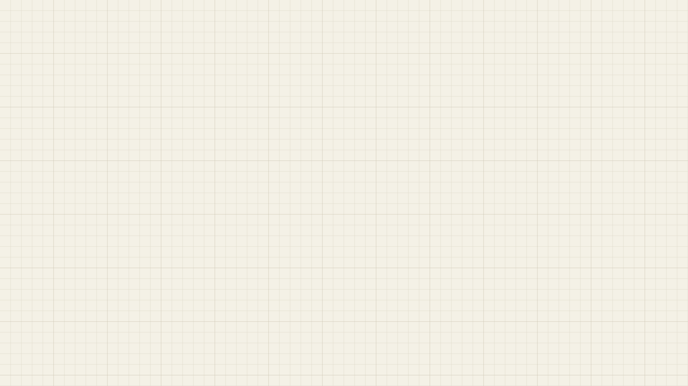

# Graph Paper Light for Omarchy

A light graph-paper theme for [Omarchy](https://omarchy.org/): warm paper surfaces, subtle grid lines, and ink-like accents inspired by classic notebook graph paper.



## Install

```bash
omarchy theme install https://github.com/<your-username>/omarchy-graph-paper-light-theme
```

> Replace `<your-username>` with your GitHub username and update the repository name if you publish under a different slug.

## Try locally

Copy this folder into your Omarchy themes directory and apply it:

```bash
cp -r /path/to/graph-paper-light ~/.config/omarchy/themes/
omarchy theme set graph-paper-light
```

## Backgrounds

- `backgrounds/01-graph-paper.png` — generated light graph-paper wallpaper (2560×1440)

Cycle backgrounds with `omarchy theme bg next`.

## Palette

Defined in `colors.toml`:

| Role | Color |
| --- | --- |
| Background | `#f4f1e6` |
| Foreground | `#2b3138` |
| Accent | `#2f6f9f` |
| Selection | `#d7d2c4` |
| Muted | `#9a9486` |

Omarchy generates application themes from `colors.toml`.

## Files

- `colors.toml` — core theme palette
- `icons.theme` — icon theme name (`Yaru-blue`)
- `backgrounds/` — theme wallpapers
- `preview.png` — theme preview image

## License

MIT
